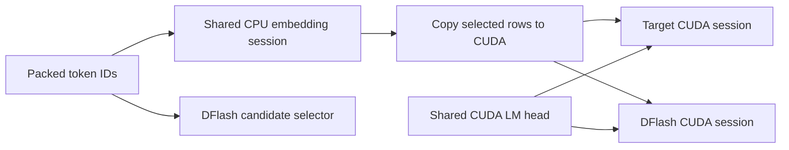

# CPU embedding with CUDA graph decoding

## Problem and design

Putting an embedding lookup on CPU inside a decoder or DFlash ONNX graph makes that session mixed-device. CUDA graph capture cannot replay the CPU lookup. Disabling capture only for prefill does not solve the mixed-device decode graph.

Export the embedding lookup as a separate CPU-only ONNX component during model construction. Run it eagerly before each target/drafter invocation, bind its output to pinned host memory, copy only the selected rows to CUDA, and bind those rows as `inputs_embeds`. The target and DFlash share one `CpuEmbedding` session and therefore one copy of the embedding table in host memory. Their LM head remains shared through the existing CUDA shared-initializer mechanism.



The target uses `VarlenGraphBuffers` for embedding storage during captured steps. This storage is included in the Engine's automatic memory budget and never grows after capture. Eager prefill owns its temporary output. DFlash uses its existing `StepTensor` mechanism, including graph retirement when a buffer grows. Embedding lookup and host-to-device copies happen before `OrtSession::Run`, outside capture. Consequently replay reads updated values at the same device address on every step.

Each target decoder and DFlash workspace stages the lookup in pinned host memory. When the device recycles host mirrors only after their upload completes (`DeviceInterface::RecyclesHostMirrorsAfterUpload`; CUDA does for mirrors up to 1 MiB, which covers decode steps), every lookup takes a fresh pooled mirror and drops the previous one without waiting for the device. Otherwise the workspace retains one allocation, reusing it across destination and shape changes until more capacity is needed, and synchronizes an outstanding upload before rewriting or releasing that memory. That path uses the device stream synchronization API, not a CUDA event; its latency cost must be included in performance measurements. DFlash reserves three times the maximum logical embedding-buffer size before cache sizing, covering an old buffer and its doubled replacement during growth.

Keep DFlash's `input_ids`: the selector also uses them. Build the separate embedding component from the decoder's original embedding weights and retain subsequent casts in each consumer. This matters when target and drafter computation use different floating point types. The CPU output must exactly match each consumer's declared type and hidden width.

## Configuration and export

The implementation reuses `model.embedding`, with CPU-only session options:

```json
{
  "model": {
    "embedding": {
      "filename": "embedding.onnx",
      "prefault": true,
      "session_options": {"intra_op_num_threads": 1},
      "inputs": {"input_ids": "input_ids"},
      "outputs": {"inputs_embeds": "inputs_embeds"}
    },
    "decoder": {"inputs": {"inputs_embeds": "inputs_embeds"}},
    "dflash2": {"inputs": {"inputs_embeds": "inputs_embeds"}}
  }
}
```

Retain the remaining configuration fields and enable `enable_cuda_graph` on the decoder/drafter as usual. Embedding session options are created independently; they do not inherit CUDA providers, graph capture, or CUDA shared initializers.

By default, CPU embedding visits every vocabulary row when the model loads. This avoids first-use page faults during prefill and decode, but moves their cost into startup: loading the measured 248,320 x 5120 FP16 model took about 1.8 seconds longer. Set `model.embedding.prefault` to `false` for cold-start-sensitive workloads; the first lookup of each row may then page fault and increase TTFT or decode latency.

Export from the original checkpoint with external decoder embeddings and the DFlash checkpoint selected:

```bash
python src/python/py/models/builder.py -i /path/to/checkpoint -o /path/to/model -p int4 -e cuda \
  --extra_options use_paged_attention=true exclude_embeds=true \
  dflash2_path=/path/to/dflash-checkpoint aux_hidden_state_layers=6,20,34,48,62
```

Choose auxiliary taps appropriate for the drafter checkpoint. Model Builder creates `embedding.onnx`, the decoder, and the drafter using the existing `Model` infrastructure. Each model owns one external-data file. The decoder and drafter reuse the source embedding weights during construction, and shared embedding/LM-head metadata follows the existing decoder/MTP sharing logic. No conversion or graph splitting after export is needed.

## Scope and tradeoffs

This path supports packed dynamic-batching Engine models with DFlash. The Generator API, static batching, and multimodal embedding pipelines are separate workflows. The embedding component preserves the selected embedding precision, dtype, and hidden width; each graph is constructed with the appropriate inputs from the outset. Tied embedding/head storage uses the existing weight-sharing policy rather than extracting or rewriting serialized nodes.

CPU lookup adds host work and a small host-to-device transfer every invocation. Target tokens produced on CUDA require readback for lookup. No latency improvement is established here. Compare GPU embedding with and without CUDA graphs, ordinary mixed CPU/CUDA execution, and this split-session path. Prefill remains eager.

For the supplied Qwen INT4 table, weights plus scales occupy 715,161,600 bytes (682.03 MiB). These move out of device memory. An eight-token lookup transfers 81,920 bytes (FP16, hidden size 5120). Allocator and graph workspace changes can make the measured peak-memory difference differ from the table size.

## Validation

1. Test native component export, including DFlash's non-embedding token-ID use, decoder/drafter weight reuse, and per-model external-data ownership.
2. Compare CPU and CUDA lookup output bytes, including repeated and boundary IDs.
3. Run the supplied model through the Engine with GPU embedding and CPU embedding, each with eager and captured decode; compare greedy token streams and drafter statistics. Include long/chunked prefill, repeated requests, and multiple batches.
4. Verify actual CUDA graph replay in both target and drafter, not just configured provider options: capture a CUDA API trace and verify repeated `cudaGraphLaunch` calls after warmup. Graph annotation logs alone do not prove replay. Record loaded library paths, phase timings, and GPU memory for all four baselines.
