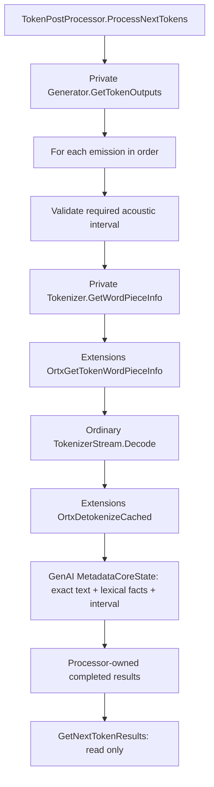

# Token Post-Processing

`TokenPostProcessor(model, generator)` owns a tokenizer, an ordinary tokenizer
stream, `MetadataCoreState`, word grouping, acoustic interval buffers, and the
results completed by the latest processing call. Configuration comes from the
model's `genai_config.json`. Callers do not create or pass token metadata records.

## Processing Loop

Create the generator and processor from the same model, after configuring the
model's timestamp level. The generator must outlive the processor. Only
`batch_size=1` and `num_beams=1` are supported; other values are rejected.

```cpp
auto postprocessor = OgaTokenPostProcessor::Create(*model, *generator);
while (!generator->IsDone()) {
  generator->GenerateNextToken();
  postprocessor->ProcessNextTokens();
  for (const auto* result : postprocessor->GetNextTokenResults()) {
    ProcessText(result->GetText());
    for (size_t index = 0; index < result->GetWordCount(); ++index)
      ProcessWord(result->GetWord(index));
    for (size_t index = 0; index < result->GetSegmentCount(); ++index)
      ProcessSegment(result->GetSegment(index));
  }
}
postprocessor->Finalize();
for (const auto* result : postprocessor->GetNextTokenResults()) {
  for (size_t index = 0; index < result->GetWordCount(); ++index)
    ProcessWord(result->GetWord(index));
  for (size_t index = 0; index < result->GetSegmentCount(); ++index)
    ProcessSegment(result->GetSegment(index));
}
```

`ProcessNextTokens()` consumes all emissions from the current generation step in
order. A step can emit zero tokens or multiple sequential tokens. Call it once
after each generation step, before advancing the generator again. There is no
generation-step counter or duplicate-processing detection.

`GetNextTokenResults()` only reads the latest results. Repeated reads do not
decode, flush, or otherwise change state. Results are per-call events, not
cumulative history; retain any history the application needs. Incremental text
and completed words/segments are alternative transcript representations: do not
append both to the same transcript.

`Finalize()` flushes the final word and unfinished segment without inserting a
token. Read its results through the same getter. Repeated finalization emits no
duplicate words or segments. `Reset()` discards pending decoding, grouping,
intervals, segments, and results together, using the processor's copied model
configuration for a fresh sequence. It does not reset the generator.

## Internal Flow



The private generator getter views existing token and interval storage without
advancing generation. It is accessible only to the native processor, not through
the public C, C++, C#, or Python generator APIs. `GenerateNextToken()` is unchanged.

Extensions owns vocabulary-specific facts: `is_special`, `starts_word`,
`ends_word`, and `boundary_style`. Its standalone lookup is independent of decoder
history and runs before ordinary decoding. It neither groups words nor owns
timestamp state. The tokenizer and stream have no timestamp configuration or
special metadata decode mode.

GenAI consumes every token, including empty decoded fragments caused by buffered
UTF-8 or skipped special tokens. Grouping preserves exact whitespace and
punctuation. Half-open token spans map to the first and last contributing acoustic
intervals by position, never by token ID. Intervals remain buffered until no
pending word or decoder output needs them. Unfinished segments persist across
processing calls.

## Configuration

Timestamp levels are `off` (default), `word`, `segment`, and `all`. Enabled
timestamps require a model that produces acoustic intervals, currently
`nemotron_speech`, with positive `sample_rate`, `hop_length`, and
`subsampling_factor`. Being an ASR model alone is not sufficient. Missing or
invalid intervals fail before decoding the affected token.

`segment_separators` defaults to `.`, `?`, and `!`. The optional
`segment_gap_threshold_seconds` is non-negative or `null`; it is rounded to the
nearest acoustic frame. Zero and positive gaps below half a frame split each word
into its own segment. When timestamps are off, ordinary text is still returned,
without timestamp records, interval buffering, or word/segment accumulation.

See [Nemotron speech timestamps](nemotron_speech_timestamps.md) for acoustic
origins and interval semantics. Diarization is not implemented by this processor.

## Bindings and Lifetime

C exposes opaque `OgaTokenPostProcessor`, `OgaTokenPostProcessorResult`, and
`OgaTokenPostProcessorTimestampRecord` handles, with typed getters for text,
timestamp presence, word/segment counts, records, frame bounds, and second bounds.
Result and record layouts are private. An out-of-range C result or record lookup
returns null; the C++ record accessor throws `std::out_of_range`.

Native results and their strings are borrowed until the next processor mutation
or destruction, not the next getter or generator operation. Never free them;
copy anything needed afterward. Operations and borrowed reads on one processor
must be externally serialized. Independent processors have independent state.

Python uses `TokenPostProcessor(model, generator)`, `process_next_tokens()`,
`get_next_token_results()`, `finalize()`, and `reset()`. Results are owned
`TokenMetadataOutput` values with `.text` and nullable `.get_timestamps()` /
`.timestamp_metadata`. Timestamp values contain `.words` and `.segments` lists
of typed `TokenMetadataTimestampRecord` values.

C# uses `TokenPostProcessor(model, generator)`, `ProcessNextTokens()`,
`GetNextTokenResults()`, `FinalizeProcessing()`, and `Reset()`. Owned
`TokenMetadataOutput` results expose `Text` and nullable `GetTimestamps()` /
`TimestampMetadata`, whose `Words` and `Segments` contain typed records.
Python and C# retain the generator and copy native results, so results survive
subsequent processing, reset, and disposal. Explicit generator disposal makes
subsequent processor mutations fail rather than accessing destroyed state.

Ordinary `TokenizerStream.Decode()` and `Reset()` remain available and unchanged
for callers needing only text. No public generator-output getter, metadata input
type, tokenizer metadata decode method, or separate metadata state handle is
required.