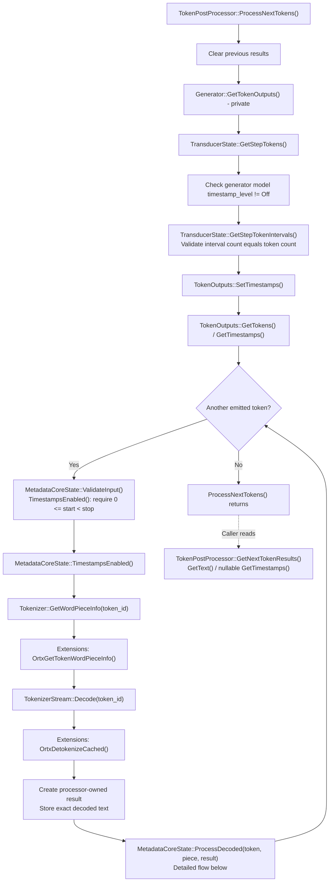
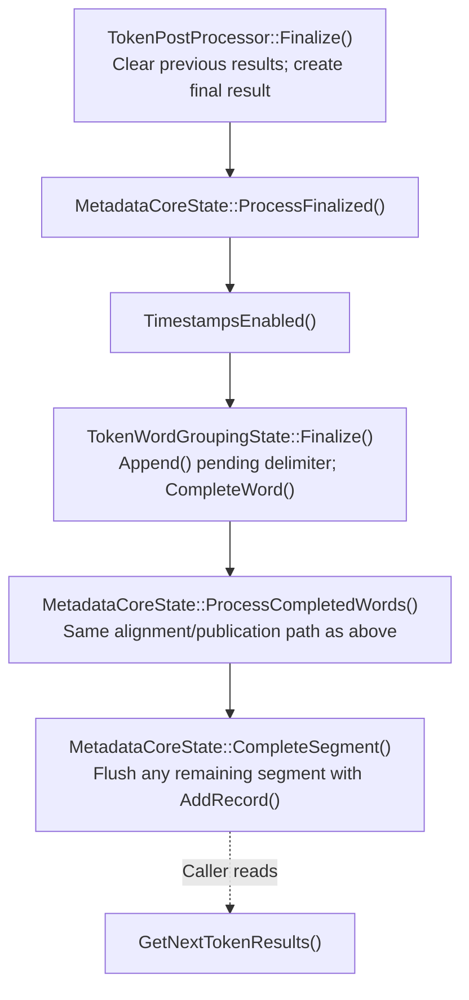

# Token Post-Processing

## Speaker attribution

One generator owns both ASR and diarization inference. Its private `GetTokenOutputs()`
returns sequential token IDs, required acoustic intervals, and optional cumulative
speaker-probability boundary sums/counts from the same generation step. The speaker
payload is internal: no public generator-output getter or token-metadata DTO is exposed.
ASR encoding and diarization run once per retained central audio chunk, not once per
emitted token. Even zero-token chunks advance diarization caches and probability sums.

`TokenPostProcessor.ProcessNextTokens()` validates each interval and speaker snapshot
before ordinary decoding, fetches Extensions lexical facts when either speech feature
needs grouping, and writes directly into its canonical `PostProcessorResult`.
Its existing `MetadataCoreState` owns grouping, pending intervals/evidence, word
speaker attribution, and unfinished turns. `TokenDiarization` supplies stateless
validation and probability-mean/argmax helpers in GenAI; Extensions owns no speech
metadata accumulation, grouping, aggregation, or segment construction.

Speaker snapshots must be finite and non-negative, with valid evaluated-frame counts
and stream-wide nondecreasing sums/counts. The last accepted snapshot remains separate
from pending words, survives finalization, and clears on processor reset. Equal
snapshots are allowed for tokens sharing a frame. Word labels are computed only when
the word completes, using its own first/last contributing token boundaries.

The same `TimestampRecord` has optional timing components and an optional speaker
label. `GetTimestamps()` is non-null when either timestamps or diarization are enabled.
With timestamps off and diarization on, it contains speaker-turn segments with no
times. `word` returns labeled words; `segment` returns labeled speaker turns.
Turns split only on speaker changes or finalization, not punctuation or silence gaps.
Timestamp-only segmentation keeps the configured punctuation/gap rules.

Native C/C++ callers check `HasTimestamp()` before scalar timing accessors, whose
absent value is zero. Python/C# timing getters return `None`/null when absent.
`GetSpeakerLabel()` / `get_speaker_label()` returns null/`None` without diarization.
These accessors use the existing borrowed handles and stale-result guards; no copied
result hierarchy or V2 API is introduced.

Flush buffered audio and run all remaining inference before the single postprocessor
finalization. Processor reset clears decoding and post-processing, not the generator
or either inference cache. Recreate/reset recording inference state separately.
If either model fails, generation fails rather than publishing incomplete combined
outputs; do not blindly retry after one branch may have advanced state.

`TokenPostProcessor(generator)` derives from `PostProcessor`, which holds the
borrowed generator reference and the virtual `Finalize()` / `Reset()` interface.
The token-specific wrapper calls `generator_.GetTokenOutputs()` and delegates to
its private `TokenPostProcessorInternal`. That internal processor owns the tokenizer,
ordinary tokenizer stream, immutable configuration, `MetadataCoreState`, and current
results. It accepts borrowed token, acoustic interval, and speaker evidence spans,
not a generator. Configuration comes from the model's `genai_config.json`.
Callers do not create or pass token metadata records.

`TokenOutputs` holds direct optional spans: when diarization is disabled,
its speaker evidence is `std::nullopt`, `GetSpeakerEvidence()` returns null, and
the generator does not request speaker evidence from the model state. No
diarization session, feature extraction, aggregation, or speaker buffering runs.
Acoustic intervals are still required with diarization on and timestamps off,
but no public timing fields are populated in that configuration.

## Processing Loop

Create the generator and processor from the same model, after configuring the
model's timestamp level. The generator must outlive the processor. Only
`batch_size=1` and `num_beams=1` are supported; other values are rejected.

```cpp
auto postprocessor = OgaTokenPostProcessor::Create(*generator);
while (!generator->IsDone()) {
  generator->GenerateNextToken();
  postprocessor->ProcessNextTokens();
  for (const auto* result : postprocessor->GetNextTokenResults()) {
    ProcessText(result->GetText());
    if (const auto* timestamps = result->GetTimestamps()) {
      for (size_t index = 0; index < timestamps->GetWordCount(); ++index)
        ProcessWord(timestamps->GetWord(index));
      for (size_t index = 0; index < timestamps->GetSegmentCount(); ++index)
        ProcessSegment(timestamps->GetSegment(index));
    }
  }
}
postprocessor->Finalize();
for (const auto* result : postprocessor->GetNextTokenResults()) {
  if (const auto* timestamps = result->GetTimestamps()) {
    for (size_t index = 0; index < timestamps->GetWordCount(); ++index)
      ProcessWord(timestamps->GetWord(index));
    for (size_t index = 0; index < timestamps->GetSegmentCount(); ++index)
      ProcessSegment(timestamps->GetSegment(index));
  }
}
```

`ProcessNextTokens()` consumes all emissions from the current generation step in
order. A step can emit zero tokens or multiple sequential tokens. Call it once
after each generation step, before advancing the generator again. There is no
generation-step counter or duplicate-processing detection.

`GetNextTokenResults()` only reads the latest results. Repeated reads do not
decode, flush, or otherwise change state. Results are per-call events, not
cumulative history; retain any history the application needs. Incremental text
and completed words/segments are alternative transcript representations: do not
append both to the same transcript.

`Finalize()` flushes the final word and unfinished segment without inserting a
token. Read its results through the same getter. Repeated finalization emits no
duplicate words or segments. `Reset()` discards pending decoding, grouping,
intervals, segments, and results together, using the processor's copied model
configuration for a fresh sequence. It does not reset the generator.

## Internal Flow

The following native method flow starts after `Generator::GenerateNextToken()`
has produced a step's token IDs and acoustic intervals. It shows timestamps
enabled; the processor handles every emission in order, including empty decoded
fragments. The language bindings forward processing to this same native path.



The private generator getter views existing token and interval storage without
advancing generation. It is accessible only to the native processor, not through
the public C, C++, C#, or Python generator APIs. `GenerateNextToken()` is unchanged.
`TokenOutputs` hides its storage behind accessors. It supplies acoustic intervals
when timestamps or diarization are enabled, and speaker evidence only for diarization.
Fully disabled acoustic metadata is null. The getter selects optional output from
the generator model's configuration directly. The transducer's cached
timestamp flag controls interval production only; it does not select the getter's
output fields. A token/interval count mismatch fails before per-token decoding.

Extensions owns vocabulary-specific facts: `is_special`, `starts_word`,
`ends_word`, and `boundary_style`. Its standalone lookup is independent of decoder
history and runs before ordinary decoding when timestamps or diarization require word grouping. It neither groups words nor owns
timestamp state. The tokenizer and stream have no timestamp configuration or
special metadata decode mode.

GenAI consumes every token, including empty decoded fragments caused by buffered
UTF-8 or skipped special tokens. Grouping preserves exact whitespace and
punctuation. Half-open token spans map to the first and last contributing acoustic
intervals by position, never by token ID. Intervals remain buffered until no
pending word or decoder output needs them. Unfinished segments persist across
processing calls.

### MetadataCoreState Calls

`ProcessDecoded()` writes into the result created by the processor; it does not
construct another output representation. `PublishWord()` evaluates word output
first, then segment output. The conditional branches below show its possible
helper calls, not concurrent processing.


The grouper buffers incomplete words, whitespace, and UTF-8 output. It may
complete zero or multiple words from one token. `AddRecord()` preserves text and
frame bounds and converts each bound to seconds with `RoundTimestamp()`. No
completed-word event means no word/segment publication, but pending intervals and
grouping state still advance. A suffix-BPE end marker can also call
`CompleteWord()` directly from `Process()`.

After the last generation step, flush pending work without decoding a token:



## Configuration

Timestamp levels are `off` (default), `word`, and `segment`; `all` is rejected. Enabled
timestamps require a model that produces acoustic intervals, currently
`nemotron_speech`, with positive `sample_rate`, `hop_length`, and
`subsampling_factor`. Being an ASR model alone is not sufficient. Missing or
invalid intervals fail before decoding the affected token.

`segment_separators` defaults to `.`, `?`, and `!`. The optional
`segment_gap_threshold_seconds` is non-negative or `null`; it is rounded to the
nearest acoustic frame before being copied into the processor configuration.
The processor also receives a model-derived `seconds_per_frame` timebase for
converting published timestamps, rather than interpreting audio preprocessing settings.
Zero and positive gaps below half a frame split each word into its own segment
in timestamp-only mode. When both timestamps and diarization are off, ordinary
text is returned without metadata, interval buffering, or word/segment accumulation.

See [Nemotron speech timestamps](nemotron_speech_timestamps.md) for acoustic
origins and interval semantics.

## Bindings and Lifetime

C exposes opaque `OgaTokenPostProcessor`, `OgaTokenPostProcessorResult`,
`OgaTokenPostProcessorTimestamp`, and
`OgaTokenPostProcessorTimestampRecord` handles, with typed getters for text,
timestamp presence, word/segment counts, records, frame bounds, and second bounds.
Result and record layouts are private. An out-of-range C result or record lookup
returns null; the C++ record accessor throws `std::out_of_range`.

Results, nested timestamp records, and native strings are borrowed until the next processor mutation
or destruction, not the next getter or generator operation. Never free them;
copy anything needed afterward. Operations and borrowed reads on one processor
must be externally serialized. Independent processors have independent state.

`MetadataCoreState` populates the processor's canonical results directly. There
is no intermediate metadata output or conversion to a second result model. The
internal processor owns one immutable configuration; metadata state reads that same object.

Python uses `TokenPostProcessor(generator)`, `process_next_tokens()`,
`get_next_token_results()`, `finalize()`, and `reset()`. Borrowed
`TokenPostProcessorResult` objects expose `get_text()` and nullable
`get_timestamps()`. Timestamp objects expose `get_words()` and `get_segments()`;
records expose `get_text()`, `get_start_frame()`, `get_stop_frame()`,
`get_start_time()`, and `get_stop_time()`.

C# uses `TokenPostProcessor(generator)`, `ProcessNextTokens()`,
`GetNextTokenResults()`, `FinalizeProcessing()`, and `Reset()`. Borrowed
`TokenPostProcessorResult` objects expose `GetText()` and nullable `GetTimestamps()`.
Timestamp objects expose `GetWords()` and `GetSegments()`; records expose
`GetText()`, `GetStartFrame()`, `GetStopFrame()`, `GetStartTime()`, and `GetStopTime()`.

Python and C# wrap the same native results without copying their payload. They
reject access to results or nested records invalidated by processing, finalization,
reset, or disposal. Repeated getters do not invalidate results. Read the result,
append needed strings and scalar values to application-owned transcript storage,
and discard the borrowed object before processing more tokens. Returned strings
and scalar values are independent values; the result wrappers are not snapshots.

Bindings retain the generator against garbage collection. C# rejects explicitly
disposed generators before entering native processing. Native C/C++ callers must
keep the generator alive until after processor destruction; no native lifetime
sentinel or generation-step counter is used.

Ordinary `TokenizerStream.Decode()` and `Reset()` remain available and unchanged
for callers needing only text. No public generator-output getter, metadata input
type, tokenizer metadata decode method, or separate metadata state handle is
required.