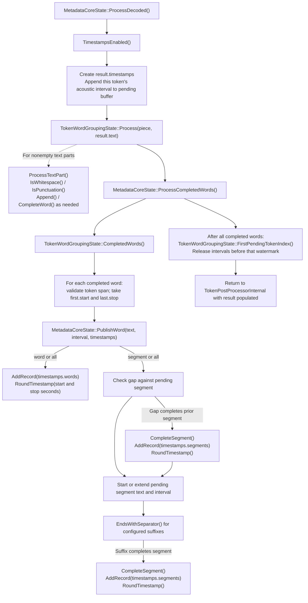
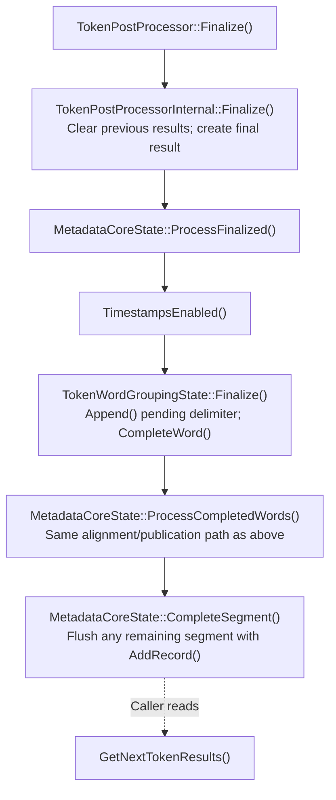

# Token Post-Processing

`TokenPostProcessor(generator)` is a generator-facing adapter around an internal
`TokenPostProcessorInternal`. That internal processor owns a tokenizer, an ordinary tokenizer
stream, `MetadataCoreState`, grouping/timing state, and the current results.
Configuration comes from the
generator's model and its `genai_config.json`. Callers do not pass a model or
create token metadata records.

## Processing Loop

Configure the model's timestamp level before creating the generator, then create
the processor from that generator alone. The generator retains its native model,
which supplies the processor configuration and tokenizer; no public model getter
or separate model ownership is required. The generator must outlive the processor. Only
`batch_size=1` and `num_beams=1` are supported; other values are rejected.

```cpp
auto postprocessor = OgaTokenPostProcessor::Create(*generator);
while (!generator->IsDone()) {
  generator->GenerateNextToken();
  postprocessor->ProcessNextTokens();
  for (const auto* result : postprocessor->GetNextTokenResults()) {
    ProcessText(result->GetText());
    if (const auto* timestamps = result->GetTimestamps()) {
      for (size_t index = 0; index < timestamps->GetWordCount(); ++index)
        ProcessWord(timestamps->GetWord(index));
      for (size_t index = 0; index < timestamps->GetSegmentCount(); ++index)
        ProcessSegment(timestamps->GetSegment(index));
    }
  }
}
postprocessor->Finalize();
for (const auto* result : postprocessor->GetNextTokenResults()) {
  if (const auto* timestamps = result->GetTimestamps()) {
    for (size_t index = 0; index < timestamps->GetWordCount(); ++index)
      ProcessWord(timestamps->GetWord(index));
    for (size_t index = 0; index < timestamps->GetSegmentCount(); ++index)
      ProcessSegment(timestamps->GetSegment(index));
  }
}
```

`ProcessNextTokens()` consumes all emissions from the current generation step in
order. A step can emit zero tokens or multiple sequential tokens. Call it once
after each generation step, before advancing the generator again. There is no
generation-step counter or duplicate-processing detection.

`GetNextTokenResults()` only reads the latest results. Repeated reads do not
decode, flush, or otherwise change state. Results are per-call events, not
cumulative history; retain any history the application needs. Incremental text
and completed words/segments are alternative transcript representations: do not
append both to the same transcript.

`Finalize()` flushes the final word and unfinished segment without inserting a
token. Read its results through the same getter. Repeated finalization emits no
duplicate words or segments. `Reset()` discards pending decoding, grouping,
intervals, segments, and results together, using the processor's copied model
configuration for a fresh sequence. It does not reset the generator.

## Internal Flow

The following native method flow starts after generation. It shows timestamps
enabled; the internal stream handles the supplied tokens in order, including empty
decoded fragments. The language bindings forward processing to this same native path.

```text
TokenPostProcessor.ProcessNextTokens()
  -> Generator.GetTokenOutputs(): view existing output without advancing generation
      -> transducer: GetStepTokens() and optional GetStepTokenIntervals()
          -> validate token/interval counts
      -> search: GetNextTokens().CopyDeviceToCpu()
  -> TokenPostProcessorInternal.Process(outputs)
      -> clear previous processing results
      -> TokenOutputs.GetTokens() / GetAcousticFrameIntervals()
      -> validate token/interval counts
      -> for each emission, in order:
          -> MetadataCoreState.ValidateInput(token)
          -> if timestamps enabled: Tokenizer.GetWordPieceInfo(token_id)
              -> OrtxGetTokenWordPieceInfo(...)
          -> TokenizerStream.Decode(token_id)
              -> OrtxDetokenizeCached(...)
          -> store exact decoded text in a result
          -> MetadataCoreState.ProcessDecoded(token, lexical facts, result)
  -> return to application

TokenPostProcessor.GetNextTokenResults()
  -> TokenPostProcessorInternal.GetNextTokenResults(): read only
  -> GetText() / nullable GetTimestamps()
```

The private generator getter borrows existing transducer token and interval storage,
or reads the existing search-selected token buffer. It does not change generation
or token selection. Nemotron continues to supply zero or one token per step, without
copying its token or interval buffers. Optional timing is selected from the model's
timestamp configuration. `GenerateNextToken()` and the decoding strategies are
unchanged.

The private getter returns an internal `TokenOutputs` with inline private spans,
not a heap-allocated PImpl. Token IDs and optional timing are separate collections;
`GetAcousticFrameIntervals()` returns null when timing is absent. The spans borrow their
producer's storage and must remain valid for `Process()`. Native timing uses
`AcousticFrameInterval` and `std::optional`, not the public C interval layout or an
integer presence flag. Public C declarations and result handles are unchanged.

### Batch and Offline Input

The internal stream accepts only token/timing values, a tokenizer, and processing
configuration. It has no Generator, model-State, audio-chunk, or arrival-time
dependency. It can process one token, a batch, or all tokens from an offline
producer, followed by `Finalize()` to flush trailing records. Batch and incremental
processing preserve the same text and timestamps for identical ordered inputs.

This does not add a public offline factory or another producer API. The public
wrapper remains `TokenPostProcessor(generator)`. A different offline producer
would need an adapter and must supply timing to obtain timestamps. Stateful
grouping does not imply an online-only input source.

Extensions owns vocabulary-specific facts: `is_special`, `starts_word`,
`ends_word`, and `boundary_style`. Its standalone lookup is independent of decoder
history and runs before ordinary decoding only when timestamps are enabled. It neither groups words nor owns
timestamp state. The tokenizer and stream have no timestamp configuration or
special metadata decode mode.

GenAI consumes every token, including empty decoded fragments caused by buffered
UTF-8 or skipped special tokens. Grouping preserves exact whitespace and
punctuation. Half-open token spans map to the first and last contributing acoustic
intervals by position, never by token ID. Intervals remain buffered until no
pending word or decoder output needs them. Unfinished segments persist across
processing calls.

### MetadataCoreState Calls

`ProcessDecoded()` writes into the result created by the processor; it does not
construct another output representation. `PublishWord()` evaluates word output
first, then segment output. The conditional branches below show its possible
helper calls, not concurrent processing.



The grouper buffers incomplete words, whitespace, and UTF-8 output. It may
complete zero or multiple words from one token. `AddRecord()` preserves text and
frame bounds and converts each bound to seconds with `RoundTimestamp()`. No
completed-word event means no word/segment publication, but pending intervals and
grouping state still advance. A suffix-BPE end marker can also call
`CompleteWord()` directly from `Process()`.

After the last generation step, flush pending work without decoding a token:



## Configuration

Timestamp levels are `off` (default), `word`, `segment`, and `all`. Enabled
timestamps require a model that produces acoustic intervals, currently
`nemotron_speech`, with positive `sample_rate`, `hop_length`, and
`subsampling_factor`. Being an ASR model alone is not sufficient. Missing or
invalid intervals fail before decoding the affected token.

The generator-facing setup reads these existing model fields once and derives
`seconds_per_frame` and the rounded segment-gap frame threshold. The internal
stream receives that optional timebase separately from word/segment output
settings. Neither it nor `MetadataCoreState` stores another set of sample rate,
hop length, and subsampling factor values. Missing or non-positive/non-finite
timebases are rejected when timestamps are enabled.

`segment_separators` defaults to `.`, `?`, and `!`. The optional
`segment_gap_threshold_seconds` is non-negative or `null`; it is rounded to the
nearest acoustic frame. Zero and positive gaps below half a frame split each word
into its own segment. When timestamps are off, ordinary text is still returned,
without timestamp records, interval buffering, or word/segment accumulation.

See [Nemotron speech timestamps](nemotron_speech_timestamps.md) for acoustic
origins and interval semantics. Diarization is not implemented by this processor.

## Bindings and Lifetime

C exposes opaque `OgaTokenPostProcessor`, `OgaTokenPostProcessorResult`,
`OgaTokenPostProcessorTimestamp`, and
`OgaTokenPostProcessorTimestampRecord` handles, with typed getters for text,
timestamp presence, word/segment counts, records, frame bounds, and second bounds.
Result and record layouts are private. An out-of-range C result or record lookup
returns null; the C++ record accessor throws `std::out_of_range`.

Results, nested timestamp records, and native strings are borrowed until the next processor mutation
or destruction, not the next getter or generator operation. Never free them;
copy anything needed afterward. Operations and borrowed reads on one processor
must be externally serialized. Independent processors have independent state.

`MetadataCoreState` populates the processor's canonical results directly. There
is no intermediate metadata output or conversion to a second result model. The
internal stream owns one immutable configuration; metadata state reads that same object.

Python uses `TokenPostProcessor(generator)`, `process_next_tokens()`,
`get_next_token_results()`, `finalize()`, and `reset()`. Borrowed
`TokenPostProcessorResult` objects expose `get_text()` and nullable
`get_timestamps()`. Timestamp objects expose `get_words()` and `get_segments()`;
records expose `get_text()`, `get_start_frame()`, `get_stop_frame()`,
`get_start_time()`, and `get_stop_time()`.

C# uses `TokenPostProcessor(generator)`, `ProcessNextTokens()`,
`GetNextTokenResults()`, `FinalizeProcessing()`, and `Reset()`. Borrowed
`TokenPostProcessorResult` objects expose `GetText()` and nullable `GetTimestamps()`.
Timestamp objects expose `GetWords()` and `GetSegments()`; records expose
`GetText()`, `GetStartFrame()`, `GetStopFrame()`, `GetStartTime()`, and `GetStopTime()`.

Python and C# wrap the same native results without copying their payload. They
reject access to results or nested records invalidated by processing, finalization,
reset, or disposal. Repeated getters do not invalidate results. Read the result,
append needed strings and scalar values to application-owned transcript storage,
and discard the borrowed object before processing more tokens. Returned strings
and scalar values are independent values; the result wrappers are not snapshots.

Bindings retain the generator against garbage collection. C# rejects explicitly
disposed generators before entering native processing. Native C/C++ callers must
keep the generator alive until after processor destruction; no native lifetime
sentinel or generation-step counter is used.

Ordinary `TokenizerStream.Decode()` and `Reset()` remain available and unchanged
for callers needing only text. No public generator-output getter, metadata input
type, tokenizer metadata decode method, or separate metadata state handle is
required.