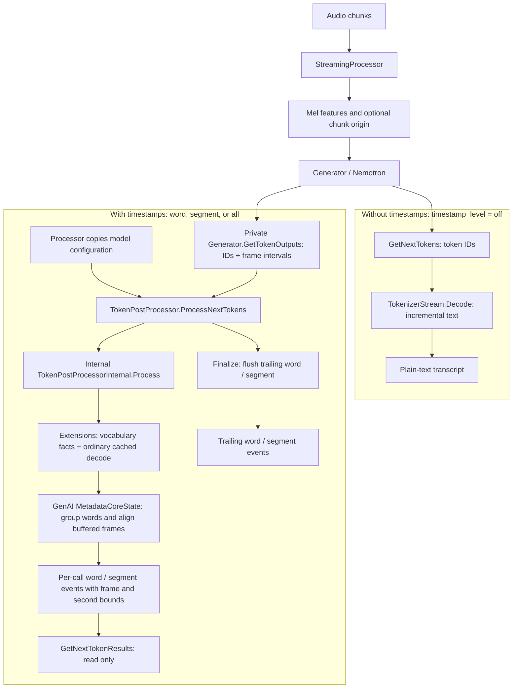

# Nemotron speech streaming timestamps

Nemotron streaming speech models can emit word and segment timestamps while preserving the same
incremental transcript fragments returned by ordinary tokenizer stream decoding.

## Model configuration

Add timestamp options under `model` in `genai_config.json`:

```json
{
  "model": {
    "timestamp_level": "all",
    "segment_separators": [".", "?", "!"],
    "segment_gap_threshold_seconds": 1.0
  }
}
```

`timestamp_level` controls timestamp generation:

| Value | Completed records |
| --- | --- |
| `off` | None (default) |
| `word` | Words |
| `segment` | Segments |
| `all` | Words and segments |

`segment_separators` is an optional array of decoded text suffixes that complete a segment. When
present, it replaces the default separators (`.`, `?`, and `!`). An empty array disables
separator-based completion.

`segment_gap_threshold_seconds` is an optional non-negative number measured in seconds. Zero splits
each word into its own segment; positive values shorter than half a frame round to the same behavior.
It is converted to the nearest encoder-frame count using half-up rounding. For a model with 80 ms frames, `1.0`
second becomes $1.0 / 0.08 = 12.5$, which rounds to 13 frames. Values below the half-frame boundary
round down. Set it to `null` or omit it to disable gap-based completion.

The frame duration comes from `sample_rate`, `hop_length`, and `subsampling_factor` under
`model` in the same `genai_config.json`; do not repeat them in metadata overrides.
If timestamps are requested for a non-Nemotron model, or these values are missing or non-positive,
config creation or overlay fails. Unknown timestamp levels and negative or non-finite gap
thresholds are rejected while loading the configuration.

## Decoding flows

Both paths start with audio processed into features, followed by generated token IDs. Model
configuration determines whether acoustic timing is produced. `TokenPostProcessor`
forwards borrowed token and optional timing views to its internal `TokenPostProcessorInternal`, which
owns decoding and timestamp processing. Ordinary tokenizer decoding is unchanged.
`timestamp_level` controls timestamp generation:



When timestamps are enabled, the streaming processor includes a scalar int64
`chunk_start_sample` tensor alongside `audio_features` in `NamedTensors`.
The origin counts samples in chunks dropped by VAD; `Flush()` pads the final chunk
for feature extraction but advances the origin by only the actual input samples.
This is a processor-to-generator signal, not an ONNX model input. Pass the complete
processor result to the generator: omitting or renaming `chunk_start_sample` is an
error when timestamps are enabled.
For a locally installed Nemotron model outside the test fixtures, set
`NEMOTRON_STREAMING_MODEL_PATH` when running
`AudioSpeechValidationTests.NemotronProcessorEmitsChunkStartSample`.
That test uses CPU session options, even when the model package specifies CUDA.

For the timed path, create `TokenPostProcessor(generator)` after configuring
the model and creating the generator. The processor obtains its model from the
generator rather than taking a separate model argument. The generator supplies
*when* each token occurred; Extensions supplies
vocabulary-derived lexical facts and ordinary decoded text. GenAI groups the words.
Each processor result also contains the ordinary incremental text fragment. Use it for live text, or collect
completed word/segment events for stable timestamped output; do not append both to one transcript.
The plain path needs no metadata state or finalization call.

Internally, GenAI buffers the frame intervals in token order until its word grouper reports
completed word spans and a pending-token watermark. It uses the first and last token
intervals of each word, accumulates unfinished segments across calls, and owns the
completed event text for the lifetime of the returned per-call result. The generator
pairs tokens and intervals by emission position, not by token ID.

The private generator getter borrows the existing per-step transducer output;
Nemotron continues to supply zero or one token per step. The internal stream accepts
ordered token/timing values and can process a whole offline batch or incremental
batches with the same finalization rules. This does not add a public offline producer API.

At setup, the generator-facing adapter calculates `seconds_per_frame` and the
rounded gap threshold once from the existing model configuration. The internal
timestamp code receives those derived values, not another copy of sample rate,
hop length, and subsampling factor. Native token input uses an optional
`std::pair<int64_t, int64_t>`; timestamp records also contain a
`std::pair<double, double>` for second bounds. Native interval layouts are not
exposed by the public C output handles or field accessors.

## Decoding

Configure timestamp level and segment rules before creating the generator and
`TokenPostProcessor`. After each generation step, call `ProcessNextTokens()`
(C++/C#) or `process_next_tokens()` (Python), then read `GetNextTokenResults()` or
`get_next_token_results()`. All sequential emissions are processed in order,
including steps that emit zero or multiple tokens. Reading results repeatedly
does not change them. The private generator getter is not exposed to applications.
Enabled timestamps require present, valid acoustic timing. Intervals are half-open
`[start, stop)` and may span multiple frames. A processor always uses its
generator's model and requires `batch_size=1` and `num_beams=1`.

`GetText()` (C++), `Text` (C#), or `text` (Python) returns the ordinary incremental
decoded fragment for partial display. Applications that need only stable output can
instead append completed word or segment event text as it arrives.

Completed words retain their original leading whitespace and attached punctuation. Segment text is
the exact concatenation of its words; no whitespace is trimmed or synthesized. After finalization,
concatenating all emitted words or all emitted segments reproduces the decoded transcript exactly.
In every binding, read and copy needed text and scalar values into the application's
transcript before the next processor mutation. Result wrappers do not retain old native output.

C exposes opaque result, `OgaTokenPostProcessorTimestampResult`, and timestamp-record
handles with typed accessors. `OgaTokenPostProcessorResultGetTimestampResult()`
returns the container; `OgaTokenPostProcessorTimestampResultGetTimestampRecord()`
selects a word or segment by `OgaTimestampRecordKind` and index. C++ exposes the
same opaque handles through method-only wrappers. Use `GetText()` and
`GetTimestampResult()` on a result, `GetWordCount()` / `GetSegmentCount()` and
`GetTimestampRecord(kind, index)` on its timestamp container, and `GetText()`,
`GetFrameInterval()`, and `GetTimestampInterval()` on a record. Text and handles remain
borrowed; interval getters return `std::pair` values without exposing native layouts.
C# and Python expose borrowed timestamp output through nullable read-only
`TimestampResult` and `timestamp_result` properties. Read records through `Words` / `Segments`
or `words` / `segments`, then read `Text`, `FrameInterval`, and `TimeInterval`
(C#) or `text`, `frame_interval`, and `time_interval` (Python). Interval values
are `(start, stop)` tuples, with named `Start` / `Stop` elements in C#.
C# properties delegate to the per-field C accessors through P/Invoke. Python
properties call the C++ wrapper getters, which use those same C accessors; no
combined-data function signature must grow when a record gains a new field.
Managed and Python objects are opaque wrappers, not dictionaries or native payload snapshots.
They are per-call event lists,
not cumulative history. Each list is
empty when that call completes no records, and it may contain multiple records when one decoded
token spans multiple word or segment boundaries. Callers retain any history they need.

After the final audio chunk, call `Finalize()` (C++), `FinalizeProcessing()` (C#),
or `finalize()` (Python), then read the results through the usual getter. It
completes pending words and segments without adding transcript text. Repeated
finalization emits no duplicate events. `Reset()` / `reset()` clears all processor
state together; it does not reset the generator. The generator must outlive its
processor. See [Token post-processing](metadata_decode.md) for the full lifecycle.

## Interval semantics

Frame and time intervals are half-open: `[start, stop)`. Each RNNT token initially covers one
encoder frame. Frame positions are absolute across all submitted audio, including chunks discarded
by VAD. Time values are seconds rounded to two decimal places.

Punctuation remains attached to its word. Segments complete on configured suffixes, configured
frame gaps, or finalization.

When `timestamp_level` is `off`, use ordinary `GetNextTokens()` and tokenizer stream `Decode()`.
The streaming processor does not create timestamp origin metadata, the transducer does not append
token intervals, and the tokenizer stream does not buffer intervals or build timestamp events.
